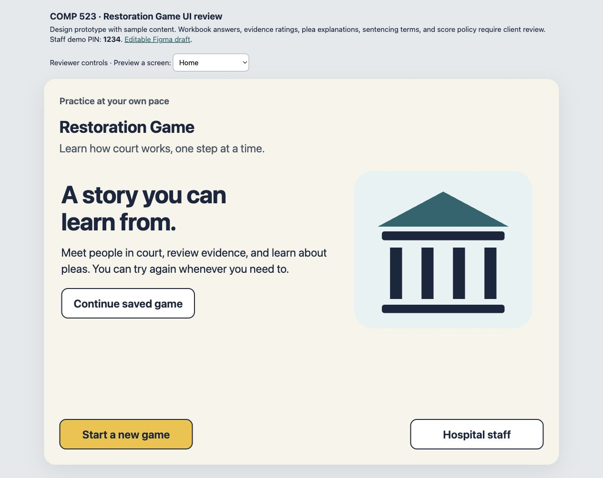

# COMP 523 Restoration Game UI

An interactive iPad UI prototype for the COMP 523 Team L Restoration Game project. This repository gives the team a shared reference for screen layouts and interactions before implementing them in SwiftUI.

## Try the prototype

Download this repository and open `index.html` in a browser. It works without installing dependencies or connecting to a backend. The reviewer controls above the app let you jump directly to a screen.

For a local preview, run:

```sh
python3 -m http.server 8000
```

Then open http://localhost:8000.

The demo staff PIN is **1234**. It is a prototype interaction, not production authentication. Progress and example scores are saved in the browser on this device. Start a new game to replace that demo session.



## What is included

- Home, start, resume, and pause interactions.
- Courtroom judge and bailiff identification with retry feedback.
- Single-choice and select-all question patterns.
- Eyewitness, video placeholder, weapon, and overall evidence screens.
- All five plea lessons, with progression blocked until all are completed.
- Plea-offer comparison and three outcome branches.
- Demo staff access and question-attempt results.
- A portrait layout with large answer rows and visible selection labels.

## Design and project references

- [UI specification and implementation notes](UI-DESIGN.md)
- [Project website](https://tarheels.live/teamlcom523/)
- [Published project specifications](https://tarheels.live/teamlcom523/specifications/)
- [Figma draft](https://www.figma.com/design/LqpNZ8xzXNIztqXSIhGzqN)

The Figma draft contains editable frames and shared components. It still has layout and interaction issues described in the design notes. The HTML prototype is the tested interaction reference.

## Content status

The storyline and screen inventory follow the published project requirements. Educational copy, rights answers, evidence ratings, plea explanations, sentencing terms, and scoring policy are placeholders or sample data requiring client review. A high demo score does not indicate competency or a clinical outcome.

The client PDFs, project video, workbook, private communications, and internal working files are not included in this repository.

## Validation

The sample walkthrough checked incorrect and correct courtroom taps, question retries, multi-select submission, all five plea lessons, the plea-offer completion gate, all three outcome branches, resume after reload, PIN error feedback, and results. Three deliberately incorrect first answers produced 12 of 15 completed checks correct on first try, or 80%.

At 820 × 1180, the portrait question had 72-pixel answer rows and no horizontal overflow. Native iPad VoiceOver, Switch Control, and Dynamic Type still need testing in the SwiftUI implementation.

## Team workflow

Use Issues or a shared checklist to agree on screen ownership. Implement one reusable question and feedback loop first, then reuse it for the remaining lessons. Keep question content, scoring, and saved progress connected to the team's backend rather than duplicating that logic in each screen.
